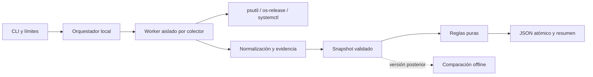

# Arquitectura propuesta

## Diseño mínimo

Una aplicación Python síncrona ejecutada bajo demanda. Sin daemon, bus de eventos,
contenedor de inyección, registro de plugins ni adaptador remoto vacío. El contrato
de snapshot es la frontera que permitirá añadir un ejecutor SSH después.



Los colectores producen registros normalizados y evidencia estructurada saneada,
no dumps de comandos. La normalización puede vivir junto a cada colector con
funciones puras para fixtures. Una falla queda confinada al colector. Assessment
recibe sólo datos validados; reporting no vuelve a inspeccionar el sistema.

## Estructura objetivo del MVP; implementar por tarea

T00–T02 crearon sólo el paquete base, CLI, modelos/schema y runner. El resto de
estos módulos pertenece a las tareas T03–T10 del plan; no adelantar módulos de
tareas posteriores.

```text
pyproject.toml
src/infralens/
  __init__.py
  __main__.py
  cli.py                 # argparse, códigos de salida
  models.py              # Pydantic; contrato y validación cruzada
  runner.py              # argv fijo, timeout, captura acotada
  scan.py                # orden, workers, deadlines y ensamblado
  collectors/
    host.py              # os-release y recursos
    processes.py         # psutil, identidad por arranque de proceso
    sockets.py           # TCP/UDP observables
    systemd.py           # capacidad y propiedades allowlist
  assessment.py          # reglas puras y condiciones de aplicabilidad
  reporting.py           # JSON y resumen; escritura segura
tests/
  unit/
  integration/
  fixtures/
```

`tests/` debe estar en la raíz, al nivel de `src/`. No introducir una clase base
para dos funciones. Tipos explícitos y funciones pequeñas bastan.

## Interfaces y flujo

- `collect(context) -> CollectorResult`: función de nivel de módulo por colector;
  contexto contiene scan_id, scope_id, deadline, presupuestos y opciones públicas.
- `run_command(argv, deadline, stdout_limit) -> CommandResult`: allowlist de ejecutables,
  sin shell, stdin cerrado, entorno mínimo (PATH controlado y LC_ALL=C), ejecutable
  resuelto en rutas de sistema confiables; nunca busca ejecutables en cwd. stdout se
  captura hasta el límite y luego se drena sin guardarlo; stderr sólo se drena y cuenta,
  nunca se conserva ni se devuelve como texto crudo.
- `assess(snapshot) -> AssessmentResult`: hallazgos y evaluación por regla
  (triggered/not_triggered/not_evaluable), con referencias de evidencia.
- `write_snapshot(snapshot, path, overwrite=False)`: valida, serializa UTF-8,
  redacta errores y publica el resultado de forma atómica con modo 0600.

El orquestador genera UUID y tiempo UTC, caracteriza contexto host/namespace,
ejecuta secuencialmente host, processes, sockets y systemd en workers separados,
valida el agregado, aplica reglas y emite salida. Un worker no se acepta parcialmente
si devuelve un objeto truncado. Una excepción inesperada se registra como error
saneado del colector y el scan continúa si queda presupuesto.

`multiprocessing` con contexto spawn permite limitar llamadas de psutil o I/O
bloqueante que un timeout de subprocess no cubre. El worker devuelve un único
objeto acotado por pipe; el padre lo drena mientras espera para evitar deadlock.
En deadline termina el worker y su grupo de procesos, espera su salida y registra
timeout. El hijo no puede crear procesos fuera de ese grupo. Probar ausencia de
huérfanos. Sin ThreadPoolExecutor: un hilo bloqueado impediría terminar a tiempo.
Cada worker Linux aplica RLIMIT_AS de 256 MiB antes de importar proveedores;
MemoryError se convierte en collection_error saneado. Es un límite de memoria
virtual, no una promesa de RSS, y debe probarse con las versiones fijadas. psutil
puede materializar listas antes de truncarlas: el límite de registros no evita por
sí solo esa asignación. No limitar memoria del proceso padre desde el producto.
Límite global 30 s, worker 5 s, systemctl individual 2 s; se usa el menor tiempo
restante. Un scan de 30 s admite hasta 2 s adicionales de limpieza controlada.

## Recolección y correlación 0.1

| Área | Fuente | Datos permitidos | Límite |
|---|---|---|---|
| Host | /etc/os-release con fallback /usr/lib/os-release; platform; psutil | id/version OS, kernel, CPU lógica, memoria total/disponible | Archivo <=64 KiB, sin shell/source |
| Filesystems | psutil disk_partitions(all=False), disk_usage | dispositivo, mountpoint, tipo, bytes total/usados/libres | 256 montajes; fallo por montaje se conserva |
| Interfaces | psutil net_if_addrs/net_if_stats | nombre, estado, direcciones IP y prefijo | 256 interfaces; sin MAC por defecto |
| Procesos | psutil process_iter | pid, create_time, name, uid si accesible | 10.000 entradas; sin argv/env/cwd/open_files |
| Sockets | psutil net_connections(kind='inet') | TCP LISTEN y UDP local ligado, IP/puerto, pid opcional | 20.000 entradas; sin conexiones salientes |
| Servicios | systemctl list-units --type=service --all --plain --no-legend --no-pager; show | id, LoadState, ActiveState, SubState, MainPID | 2.000 unidades; propiedades acotadas y lotes |

systemd: comprobar ejecutable y `/run/systemd/system`; si hay runtime pero falla
el bus, reportar error/permiso, no unsupported. `list-units` cubre unidades cargadas,
no todos los unit files instalados: declarar ese alcance en el resultado. Analizar
sólo el primer token (nombre) de list-units y usar `show --property=Id,LoadState,ActiveState,SubState,MainPID`
con nombres validados y separador `--`. Nunca incluir Description, Environment,
ExecStart ni contenido de unidades. Fixtures de distintas salidas y nombres escapados.

psutil puede omitir sockets sin error cuando faltan privilegios en Linux. Por eso
el resultado de sockets sin privilegios es siempre partial con motivo
`visibility_not_guaranteed`; jamás declara completitud del host aunque retorne datos.
Incluso con root la cobertura se refiere al namespace y al intervalo, no a un host
atómico. Las listas no son transaccionales: registrar tiempos por colector.

Relaciones 0.1: socket owned_by proceso y service main_process proceso. Se marca
observed sólo si PID y create_time coinciden en lecturas antes/después del vínculo;
para MainPID, releer también MainPID y estado de unidad. Si hay carrera, omitir
relación y registrar limitación. No garantizar identidad con sólo un PID. No deducir
aplicación, topología ni dependencia funcional. Conexiones salientes se posponen.

## Evolución

En 0.2, diff consume dos snapshots y exige mismo scope_id, schema major y contexto;
compara servicios y listeners por claves naturales, no UUID, CPU libre ni PID.
Un dato no observado por pérdida de cobertura es `not_comparable`, no removed.

SSH posterior invocará el mismo CLI empaquetado en el host autorizado y recuperará
el mismo JSON mediante OpenSSH (host keys estrictas, BatchMode, sin copiar claves
ni instalar automáticamente). Exigir Python compatible o importación offline;
no prometer hosts sin Python. Mantener un scan por host; un manifiesto agrega
resultados. Diseñar inventario y confianza de host sólo cuando llegue esa entrega.

## Seguridad y alcance de confianza

Sin sudo automático, instalaciones, cambios de estado de servicio ni sondeo de
red. Lecturas pueden causar I/O y huellas de auditoría; read-only no significa
impacto cero. No se consulta machine-id ni /proc/*/environ. scope_id es UUID
aportado por usuario o generado por scan, nunca derivado de un secreto del host.
Identificar namespaces por inodos de `/proc/self/ns/{pid,net,mnt}` si accesibles,
y boot_id si se permite; si no, declarar contexto desconocido, sin inventarlo.
Hostname e IP son información sensible aunque no sean secretos.

Archivo JSON privado por defecto, sin upload ni telemetría; salida terminal elimina
caracteres de control/ANSI de nombres. Errores exponen códigos y mensajes propios,
no stderr arbitrario, rutas de credenciales o traceback. Modo debug sólo diagnóstico
saneado. No prometer anonimización automática: revisar informes antes de compartir,
eliminar al terminar y no agregarlos a Git. Incluso nombres de procesos, unidades
o mountpoints pueden contener texto sensible elegido por terceros: la allowlist
reduce riesgo pero no garantiza ausencia de secretos en esos nombres. Las pruebas
de canarios validan fuentes prohibidas concretas, no una detección universal. Amenazas: binarios falsos en PATH,
symlinks en salida, output enorme, procesos que desaparecen y entradas maliciosas.
