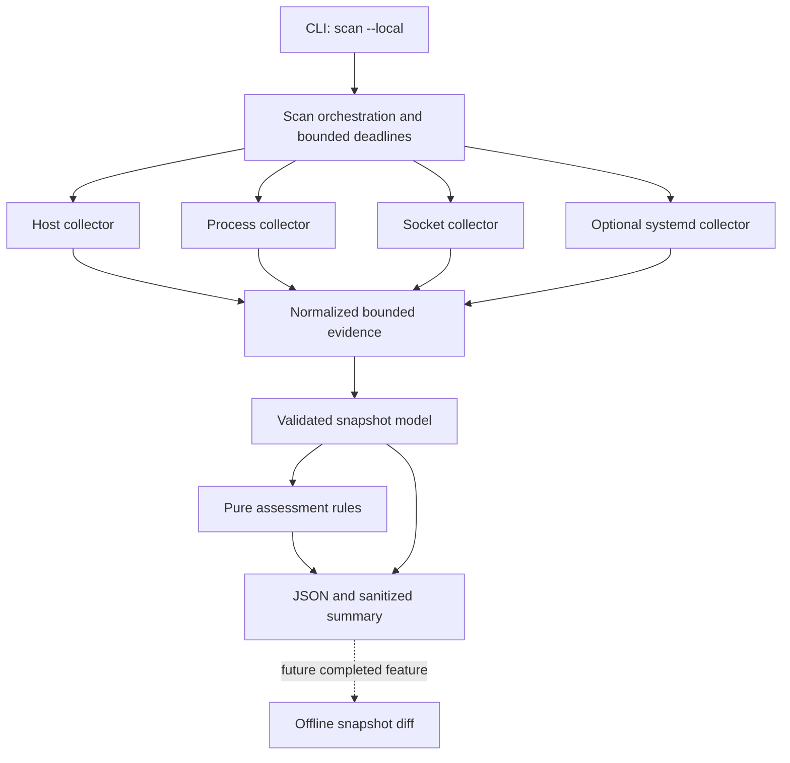

# InfraLens — System design at a glance

InfraLens is an **on-demand local Linux evidence collector**, not a daemon, continuous monitor, vulnerability scanner, remote inventory or remediation tool. The MVP produces a versioned JSON snapshot and explains coverage and limitations. The current work on offline snapshot comparisons is incremental; do not treat an end-to-end diff as complete until its classification and output are implemented.

## Implementation flow



The diagram simplifies the actual isolation model. See [ARCHITECTURE.md](ARCHITECTURE.md) for collector workers, timeout/command handling, data validation and design decisions; [DATA_CONTRACT.md](DATA_CONTRACT.md) for snapshot semantics and [TEST_STRATEGY.md](TEST_STRATEGY.md) for validated environments.

## Safe local demo

```bash
uv sync --frozen --extra dev
uv run infralens scan --local --output ./snapshot.json
```

A snapshot may include hostnames, IP addresses, service names, process names and mount points. Keep it private and sanitize a copy before sharing. The file is written with mode `0600`, and an existing destination requires `--overwrite`. `--fail-on-partial` returns status 3 **after writing the snapshot** when coverage is incomplete.

Do not suggest scanning enterprise hosts without authorization. Privilege, OS and namespace boundaries may reduce coverage; an empty observed result is not necessarily evidence of absence.

## Scope and maturity

| Area | Current documented scope |
| --- | --- |
| Local scan | MVP 0.1: CLI, bounded collectors, structured evidence, assessment and reporting |
| systemd | Optional; Linux/systemd runner validation is described in the project's test strategy |
| Snapshot reader | Offline, version-aware reader in 0.2 work |
| Comparisons | Preflight and matching helpers exist; complete result classification/output is not yet claimed |
| Docker, SSH, cloud | Not part of implemented MVP |

The technical documents were written alongside implementation and include some **target-state** notes. Use the code and tests to resolve discrepancies; do not represent future modules as shipped functionality.
